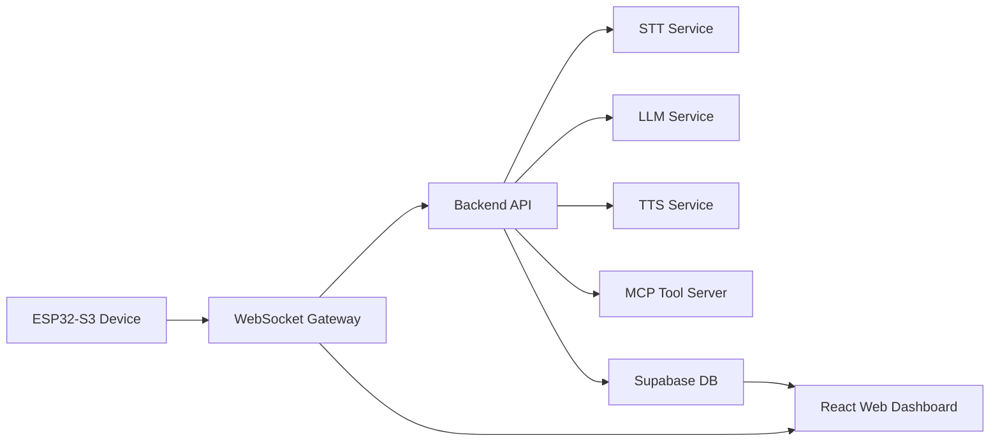

# IntelliVo Blueprint

## 1. Recommendation

For your product, I recommend this stack:

- Frontend: React + TypeScript + Vite
- Backend: FastAPI (Python) or Node.js
- Database: Supabase (PostgreSQL + Auth + Realtime)
- Real-time communication: WebSockets for device-to-backend streaming
- AI services: cloud APIs for STT, TTS, and LLM
- MCP tools: a small custom MCP server for reminders, timers, study logging, and task actions

### Why Supabase instead of Firestore?

I recommend Supabase over Firestore for this project because your app is not just a simple document store. IntelliVo needs:

- relational data models
- analytics queries across sessions and tasks
- auth and row-level security
- real-time subscriptions for live dashboards
- easier SQL joins for productivity insights

Firestore is fine for simple apps, but Supabase gives you PostgreSQL, which is a better fit for student productivity analytics and future reporting features.

---

## 2. High-level architecture



### Role breakdown

- ESP32-S3: captures voice input, handles button input, displays status, and streams audio to the backend.
- Backend: orchestrates STT, LLM, TTS, and MCP tools.
- Supabase: stores users, sessions, tasks, reminders, analytics events, and realtime updates.
- React dashboard: shows productivity analytics, session trends, and assistant activity.

---

## 3. Recommended tech stack

### Frontend

- React + TypeScript
- Vite
- Tailwind CSS
- React Query / TanStack Query
- Recharts or Chart.js for analytics visuals
- WebSocket client for live updates

### Backend

- FastAPI (recommended for AI integrations)
- Python 3.11+
- Pydantic for request/response models
- WebSockets for live device communication
- HTTP endpoints for REST API

### Database

- Supabase PostgreSQL
- Supabase Auth
- Supabase Realtime
- Row-level security for user data isolation

### AI services

- STT: OpenAI Whisper API or Azure Speech-to-Text
- LLM: OpenAI GPT-4o-mini / GPT-4.1-mini or Azure OpenAI
- TTS: Azure Speech or ElevenLabs

### MCP layer

- A lightweight MCP server that exposes tools such as:
  - create reminder
  - start timer
  - log study session
  - fetch tasks
  - mark task complete
  - get daily summary

---

## 4. Where the AI pieces come from

### Speech-to-Text (STT)

Use a cloud STT provider because running speech recognition locally on the ESP32-S3 is not practical.

Recommended:

- OpenAI Whisper API
- Azure Speech-to-Text

### Text-to-Speech (TTS)

Recommended:

- Azure Speech
- ElevenLabs

### LLM / conversation engine

Recommended:

- OpenAI GPT-4o-mini
- Azure OpenAI

### MCP tools

MCP is not the model itself. It is the tool interface layer.

The backend should call your MCP server when the assistant needs to perform actions.

Example tools:

- setReminder(title, time)
- startPomodoro(duration)
- logStudySession(topic, minutes)
- getTodayTasks()
- createTask(title, priority)

---

## 5. Suggested system flow

### A. Voice capture on device

1. User presses the button on ESP32-S3.
2. Device records audio.
3. Device sends audio chunks over WebSocket to backend.

### B. Backend processing

1. Backend receives audio.
2. STT converts speech to text.
3. LLM interprets the user request.
4. If needed, backend calls MCP tools.
5. TTS converts the assistant response to speech.
6. Backend sends audio or text back to the device.

### C. Dashboard updates

1. Backend writes events to Supabase.
2. Frontend subscribes to Supabase Realtime.
3. Dashboard updates in real time with:
   - study sessions
   - focus trends
   - reminders
   - task completion
   - assistant interactions

---

## 6. Suggested project structure

```text
intellivo/
  firmware/
    src/
      main.cpp
      app/
      hardware/
    platformio.ini

  backend/
    app/
      main.py
      routers/
      services/
      models/
      websocket/
      mcp/
    requirements.txt

  web/
    src/
      components/
      pages/
      hooks/
      services/
      styles/
    package.json

  infra/
    docker-compose.yml
    env.example
```

---

## 7. Data model ideas

### Users

- id
- email
- name
- created_at

### Sessions

- id
- user_id
- started_at
- ended_at
- duration_minutes
- topic
- mood

### Tasks

- id
- user_id
- title
- status
- priority
- due_at
- created_at

### Reminders

- id
- user_id
- message
- scheduled_for
- status

### Analytics events

- id
- user_id
- event_type
- payload
- created_at

---

## 8. Recommended MVP plan

### Phase 1: Core voice assistant

- ESP32-S3 button press
- audio capture
- send to backend
- STT + LLM + TTS flow
- simple device response

### Phase 2: Productivity tools

- reminders
- timers
- task creation
- study session logging

### Phase 3: Analytics dashboard

- dashboard charts
- focus trends
- time usage patterns
- completion metrics

### Phase 4: Personalization

- user preferences
- adaptive recommendations
- memory of recurring habits

---

## 9. Final recommendation

If you want the best balance of speed, reliability, and future growth, choose:

- React + TypeScript for the web app
- Supabase for database, auth, and realtime
- FastAPI for backend orchestration
- WebSockets for live voice communication
- OpenAI Whisper / GPT / Azure Speech for AI features

This gives you a strong foundation for a real student productivity assistant instead of a brittle prototype.
