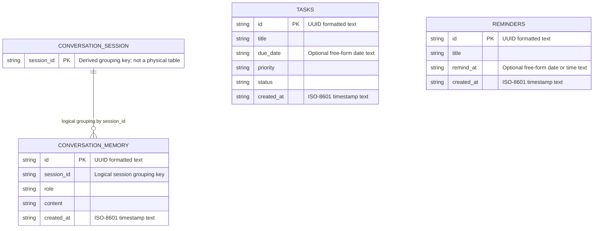

# Kasarita Entity-Relationship Diagram and Data Dictionary

## 1. Purpose and Scope

This document describes the persistent data structures identified in the Kasarita source code and database definitions. The backend uses SQLite as its local database and can use Supabase for task and reminder operations; the web client also stores user and application state as a JSON object in browser `localStorage`, which is not a relational database.

The diagram and dictionary below distinguish physical database tables from logical groupings and client-side objects. All sample values are synthetic and are provided for academic illustration only.

## 2. Persistence Overview

**Table 1. Kasarita persistence layers and their roles**

| Persistence layer | Data structures | Role |
|---|---|---|
| SQLite | `tasks`, `reminders`, `conversation_memory` | Local backend persistence. The tables are created by the backend when it initializes the database. |
| Supabase | `tasks`, `reminders` | Optional remote persistence described by `backend/supabase_schema.sql`. The checked-in schema does not currently define `conversation_memory`. |
| Browser `localStorage` | User records, task/event/message objects, gamification state, device state | Client-side JSON state saved under the `kasarita_state_v3` key. These objects are not database tables and have no database-enforced relationships. |

> **Schema alignment note.** The backend can send conversation-memory requests to Supabase, but the supplied Supabase schema has no `conversation_memory` table. The memory code falls back to SQLite when a Supabase memory operation fails. Therefore, the Supabase DDL as currently supplied does not fully represent every backend persistence structure.

## 3. Entity-Relationship Diagram

**Figure 1. Kasarita persistent data entities and logical conversation grouping**

The session key in this figure is a logical grouping derived from `conversation_memory.session_id`; it is not a separately stored table. The grouping indicates that a session may have zero or many messages and that each message has one session identifier. The relationship is not backed by a declared SQL foreign-key constraint. `tasks` and `reminders` have no declared relationships to the other tables.

<!-- mermaid-checked: every attribute is `<type> <name> [<key>] ["<description>"]` with at most one of PK/FK/UK, no \n in descriptions, no {} in descriptions, every relationship label is double-quoted -->

### 3.1 Relationship Cardinalities

**Table 2. Entity cardinalities represented in the data model**

| Relationship | Cardinality | Interpretation | Enforcement |
|---|---|---|---|
| `CONVERSATION_SESSION` to `CONVERSATION_MEMORY` | One session to zero or many messages; each message carries one session identifier | Messages are grouped by the value in `session_id`. | Logical association only; there is no session table or SQL foreign-key constraint. |
| `TASKS` to other database entities | No declared relationship | A task has no `user_id`, reminder ID, or other foreign key in the current schema. | No relationship is enforced. |
| `REMINDERS` to other database entities | No declared relationship | A reminder has no `user_id`, task ID, or other foreign key in the current schema. | No relationship is enforced. |

## 4. Relational Data Dictionary

The backend's SQLite DDL declares these fields with SQLite `TEXT` storage. The Supabase DDL uses PostgreSQL `text` for task and reminder string fields and `timestamptz` for their `created_at` fields. Field size below means the declared or application-level size, not a claim that SQLite `TEXT` has a fixed-width storage size.

### 4.1 `tasks`

**Table 3. Data dictionary for `tasks`**

| Field name | Type | Field size | Nullability / key | Description |
|---|---|---|---|---|
| `id` | SQLite `TEXT`; Supabase `text` | No declared maximum; application generates a 36-character UUID string | Not null; primary key | Unique task identifier. |
| `title` | SQLite `TEXT`; Supabase `text` | No declared maximum | Not null | Task title or description. |
| `due_date` | SQLite `TEXT`; Supabase `text` | No declared maximum; optional free-form value | Nullable | Due date or date expression, for example `2026-11-02` or `tomorrow`; the schema does not enforce a date format. |
| `priority` | SQLite `TEXT`; Supabase `text` | No declared maximum; application uses values such as `low`, `normal`, or `high` | Not null | Task priority. Supabase declares a `normal` default; the SQLite DDL does not declare a default. |
| `status` | SQLite `TEXT`; Supabase `text` | No declared maximum; application uses values such as `pending` or `completed` | Not null | Current task status. Supabase declares a `pending` default; the SQLite DDL does not declare a default. |
| `created_at` | SQLite `TEXT`; Supabase `timestamptz` | SQLite: no declared maximum; application writes an ISO-8601 timestamp. Supabase: timestamp with time zone | Not null | Creation time. |

### 4.2 `reminders`

**Table 4. Data dictionary for `reminders`**

| Field name | Type | Field size | Nullability / key | Description |
|---|---|---|---|---|
| `id` | SQLite `TEXT`; Supabase `text` | No declared maximum; application generates a 36-character UUID string | Not null; primary key | Unique reminder identifier. |
| `title` | SQLite `TEXT`; Supabase `text` | No declared maximum | Not null | Reminder title or description. |
| `remind_at` | SQLite `TEXT`; Supabase `text` | No declared maximum; optional free-form value | Nullable | Reminder date or time. The schema does not enforce a date/time format. |
| `created_at` | SQLite `TEXT`; Supabase `timestamptz` | SQLite: no declared maximum; application writes an ISO-8601 timestamp. Supabase: timestamp with time zone | Not null | Creation time. |

### 4.3 `conversation_memory`

**Table 5. Data dictionary for `conversation_memory`**

| Field name | Type | Field size | Nullability / key | Description |
|---|---|---|---|---|
| `id` | SQLite `TEXT` | No declared maximum; application generates a 36-character UUID string | Not null; primary key | Unique stored message identifier. |
| `session_id` | SQLite `TEXT` | No declared maximum | Not null; not a declared foreign key | Session grouping value. An empty value is replaced by `default` in the backend. |
| `role` | SQLite `TEXT` | No declared maximum; application uses values such as `user` and `assistant` | Not null | Message role. |
| `content` | SQLite `TEXT` | No declared maximum | Not null | Stored message text. |
| `created_at` | SQLite `TEXT` | No declared maximum; application writes an ISO-8601 timestamp | Not null | Message creation time. |

The checked-in Supabase DDL does not define this table. Its field types above describe the SQLite implementation.

## 5. Client-Side JSON Data Structures

The browser persists additional state as JSON rather than as relational tables. The following summary is included to clarify the boundary of Figure 1; field sizes are not constrained by a database schema.

**Table 6. Principal client-side objects stored in browser state**

| Object or collection | Representative fields | Type and field size |
|---|---|---|
| User | `id`, `name`, `email`, `password` | Strings; variable length with no schema-defined maximum. |
| User task | `id`, `title`, `category`, `priority`, `status`, `due`, `notes`, `completedOn` | String identifiers and text fields; `completedOn` may be absent. No database size limits. |
| Event | `id`, `title`, `date`, `time`, `type` | String fields; no database size limits. |
| Chat message | `id`, `role`, `content`, `source`, `timestamp` | String fields; no database size limits. |
| Gamification state | `xp`, `streak`, `lastStudyDate`, `achievements`, `quests`, `subjectTime` | Numeric counters, date string, arrays of objects, and a subject-to-number map. |
| Device state | `connected`, `wakeWord`, `lastSync` | Boolean fields and a timestamp string. |

These client-side objects are separate from the backend tables. In particular, a browser task's `category`, `notes`, and `completedOn` fields are not defined by the backend `tasks` table, and the backend task table does not associate a task with a user.

## 6. Synthetic Sample Records

The following sample values demonstrate the field formats. They do not reproduce records from the application's local database.

### 6.1 Sample `tasks` Records

**Table 7. Illustrative task records**

| `id` | `title` | `due_date` | `priority` | `status` | `created_at` |
|---|---|---|---|---|---|
| `8f14e45f-ea1a-4f20-9c7b-6c2f1e9a1001` | Complete database laboratory report | `2026-11-02` | `high` | `pending` | `2026-10-01T09:00:00+00:00` |
| `8f14e45f-ea1a-4f20-9c7b-6c2f1e9a1002` | Review data structures | `2026-11-05` | `normal` | `completed` | `2026-10-01T10:30:00+00:00` |

### 6.2 Sample `reminders` Records

**Table 8. Illustrative reminder records**

| `id` | `title` | `remind_at` | `created_at` |
|---|---|---|---|
| `9a14e45f-ea1a-4f20-9c7b-6c2f1e9a2001` | Review laboratory submission | `2026-11-01T18:00:00+08:00` | `2026-10-01T11:15:00+00:00` |

### 6.3 Sample `conversation_memory` Records

**Table 9. Illustrative conversation-memory records**

| `id` | `session_id` | `role` | `content` | `created_at` |
|---|---|---|---|---|
| `a214e45f-ea1a-4f20-9c7b-6c2f1e9a3001` | `demo-session-01` | `user` | `Explain primary keys in simple terms.` | `2026-10-01T12:00:00+00:00` |
| `a214e45f-ea1a-4f20-9c7b-6c2f1e9a3002` | `demo-session-01` | `assistant` | `A primary key uniquely identifies one row in a table.` | `2026-10-01T12:00:04+00:00` |

## 7. Data Integrity and Interpretation Notes

1. The current SQL schema defines primary keys but no foreign keys, unique constraints beyond the primary keys, or database-level checks for `priority`, `status`, or date formats.
2. The browser stores a separate user-centric copy of tasks and other application state; the current backend relational schema does not provide a user table or user ownership columns.
3. In the client source, user objects include a `password` field and are persisted in browser `localStorage`. The observed code does not hash that value or apply field-level encryption. The client-side model should therefore be interpreted as a demonstration/local state model, not as a secure server-side authentication schema.
4. `conversation_memory.content` is free-form text and may contain personal information entered during a conversation. The schema itself does not define field-level masking or encryption.
5. A database migration that formalizes task ownership, reminder ownership, conversation-session ownership, or strict field validation would require schema changes not present in the current implementation.

## 8. Source Basis

This data model was derived from the backend SQLite initialization and CRUD operations in `backend/app/mcp.py`, the declared remote schema in `backend/supabase_schema.sql`, and the client state model in `frontend/src/context/store.jsx`.
