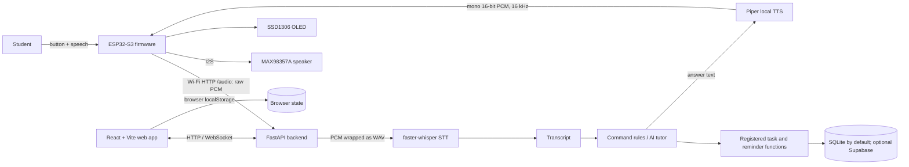

# Kasarita Thesis Proposal and Defense Guide

> **Use this as a preparation guide, not as evidence of results.** It is grounded in the source code currently in this repository. It cannot guarantee every question a panel may ask. Replace every **[TO BE COMPLETED]** item with approved study details and actual test results. Never present a planned test, an intended feature, or an example value as a completed result.

## 1. Working thesis framing

The existing implementation plan gives this working title:

> **Kasarita: An MCP-Enabled ESP32-S3 Voice-Driven Student Productivity and Learning Management System with Real-Time Web Integration**

Confirm the final title with the adviser and institution. The source code supports describing Kasarita as a **prototype** that combines an ESP32-S3 push-to-talk voice interface, a FastAPI backend, speech recognition, configurable AI tutoring, controlled task/reminder tools, persistence, and a React web dashboard. Do not claim that every feature implied by “learning management system,” “real-time,” “MCP,” or “voice-driven” is production-complete: the actual implemented scope and gaps are identified below.

### Proposal-ready overview

Kasarita is a student productivity assistant prototype intended to let a student use spoken or typed requests to interact with tasks, reminders, and an AI tutor. For the device flow, a button-activated ESP32-S3 captures mono 16-bit audio at 16 kHz and uploads raw PCM over Wi-Fi to a FastAPI service. The backend wraps the samples as WAV, transcribes them with a locally run `faster-whisper` model when available, routes supported task and reminder commands to registered backend functions, and sends other recognized questions to a configurable OpenAI-compatible chat-completion provider when configured. For spoken device responses, the backend synthesizes cleaned text with Piper and returns mono 16-bit PCM at 16 kHz; the ESP32 streams it to an I2S speaker. Task and reminder records are stored in SQLite by default, with optional Supabase REST storage. A React dashboard provides task, chat, study, progress, and settings views; browser state is also saved locally.

The prototype should be evaluated on **measured** criteria such as successful audio capture/upload, transcription performance on a defined test set, command-routing/action correctness, response latency, task persistence, and usability. The repository does not establish a participant count, approved study protocol, measured accuracy, latency threshold, or user-study result. Those are not to be invented.

### One-minute opening statement

“Our project is Kasarita, a prototype student productivity assistant with a physical voice interface and a web companion. A push button starts recording on the ESP32-S3. The device uploads 16-kilohertz, mono, 16-bit PCM audio to our FastAPI backend. The backend transcribes the audio, checks whether the text matches a supported task or reminder command, and either executes a registered backend action or sends a question to the configured AI tutor. The response is converted to speech by Piper and played by the device; tasks and reminders use SQLite locally or optional Supabase storage. Our contribution is the integration of embedded audio capture, speech and intent processing, bounded tool actions, persistence, and a web interface. We will report performance only from the tests defined in our methodology; known limitations include [state the most relevant limitations honestly].”

## 2. System architecture and how the folders cooperate

The diagram is a logical summary, not a claim that audio is streamed continuously over a WebSocket. The current hardware audio path is a complete HTTP `POST /audio` upload; the browser text chat uses a WebSocket where available and falls back to HTTP.

### Repository map

| Folder/file | Role in the system |
|---|---|
| [`platformio.ini`](../platformio.ini) | PlatformIO build configuration: ESP32-S3 development board, Arduino framework, flash/memory settings, and Arduino library dependencies. |
| [`src/main.cpp`](../src/main.cpp) | Firmware entry point. Initializes serial, OLED, button, microphone, and speaker; attempts Wi-Fi/backend startup; then repeatedly updates the device state machine. |
| [`src/app/`](../src/app/state_machine.cpp) | Application behavior. `state_machine.cpp` coordinates idle, push-to-talk recording, upload, display feedback, spoken response, and error tones. The state definitions are in `state_machine.h`. |
| [`src/hardware/`](../src/hardware/microphone.cpp) | Hardware drivers. `microphone.cpp` configures I2S input and allocates/reads the recording buffer; `button.cpp` reads the active-low button; `display.cpp` writes status text to the OLED; `speaker.cpp` configures I2S output and provides tone/audio playback. Each module has a matching header. |
| [`src/backend_bridge.cpp`](../src/backend_bridge.cpp) | Wi-Fi connection and HTTP client functions used by firmware: text `/chat`, PCM `/audio`, and response `/tts`. This is also where device-side network configuration currently resides. |
| [`include/pins.h`](../include/pins.h) | Central mapping of the button, INMP441 I2S, MAX98357A I2S, and OLED I2C pins. |
| [`lib/`](../lib/) | PlatformIO local-library area. Its current README is a placeholder; dependencies used by the firmware are declared in `platformio.ini`. |
| [`backend/app/main.py`](../backend/app/main.py) | FastAPI application and HTTP/WebSocket routes. Validates audio, orchestrates transcription, command routing, AI calls, Piper TTS, and task/memory API endpoints. |
| [`backend/app/mcp.py`](../backend/app/mcp.py) | Backend tool and data layer. Defines SQLite/Supabase access, task/reminder operations, speech-text cleanup, memory functions, tool registry, and rule-based command interpretation. |
| [`backend/tests/`](../backend/tests/) | Backend automated tests, including route/command behavior and memory/TTS-related behavior. Test coverage is not equivalent to a full hardware or user study. |
| [`backend/requirements.txt`](../backend/requirements.txt) | Python backend dependencies, including FastAPI, `faster-whisper`, and Piper. |
| [`backend/models/`](../backend/models/) | Local Piper voice model files. The backend default setting points to `en_US-lessac-medium.onnx`; another model is used only if `PIPER_MODEL` is configured accordingly. Review each model's license before redistribution. |
| [`backend/data/`](../backend/data/) | Default local SQLite data location. Database files are runtime data, not source code or a thesis result. |
| [`backend/supabase_schema.sql`](../backend/supabase_schema.sql) | Supabase DDL for tasks and reminders. It does not currently define the conversation-memory table used by the SQLite backend. |
| [`backend/.env.example`](../backend/.env.example) | Example backend settings. Actual API keys and private configuration belong in a local, untracked environment file. |
| [`frontend/src/main.jsx`](../frontend/src/main.jsx), [`frontend/src/App.jsx`](../frontend/src/App.jsx) | React entry point, global provider, app shell, and currently mounted page routes. |
| [`frontend/src/context/store.jsx`](../frontend/src/context/store.jsx) | Browser application state, local persistence, task API calls, chat transport, study timer, and gamification state. |
| [`frontend/src/components/`](../frontend/src/components/Sidebar.jsx) | Reusable navigation, modal, task/event form, task row, and device-widget components. |
| [`frontend/src/pages/`](../frontend/src/pages/Dashboard.jsx) | Screen-level UI. Dashboard, tasks, chat, study, progress, settings, and auth are mounted through `App.jsx`. Other page files exist but are not necessarily reachable from the current navigation. |
| [`frontend/src/utils.js`](../frontend/src/utils.js) | Shared browser helpers for IDs, dates, task statistics, and browser speech synthesis. |
| [`frontend/package.json`](../frontend/package.json) | Vite/React scripts and front-end dependencies. |
| [`documentation/`](./) | Existing plans, progress notes, data dictionary, blueprint, and this defense guide. Plans and progress notes describe intent or reported status; verify them against current code and fresh test logs before presenting claims. |
| `.pio/`, `frontend/node_modules/`, `frontend/dist/`, `backend/.venv/`, Python caches | Generated build, installed dependency, or runtime directories. They are not the application's authored source folders and should not be described as implemented modules. |

### Source-level call sequence

1. `src/main.cpp` initializes the peripherals and calls `initNetwork()`. The main loop repeatedly calls `stateMachineUpdate()`.
2. In `IDLE`, `src/app/state_machine.cpp` waits for `buttonIsDown()`. In `LISTENING`, it displays “Recording...” and calls `recordAudioWhilePressed()`.
3. `src/hardware/microphone.cpp` reads I2S microphone samples into a heap allocation. It stops when the button is released or the buffer reaches its maximum.
4. The state machine calls `sendAudioToBackend()`. `src/backend_bridge.cpp` posts the captured bytes to `/audio` with `Content-Type: audio/pcm` and an ESP32 device identifier header.
5. `backend/app/main.py` validates the content type and even byte length, then calls `transcribe_pcm()` in a worker thread. Transcription makes a mono, 16-bit, 16-kHz WAV container from the uploaded sample bytes and calls the cached `faster-whisper` model.
6. If a transcript exists, the backend first tries the deterministic `interpret_command()` rules from `mcp.py`. Supported operations call only registered handlers (`create_task`, `get_tasks`, `complete_task`, `update_task`, `delete_task`, `create_reminder`, `get_schedule`). If it is not a recognized command, the AI route may answer or select a declared tool when an AI API key is configured; otherwise the tutor returns its configuration/error response.
7. The API returns JSON, including status and when available transcript, answer, and action. The firmware displays the response. For an answer, it calls `/tts`; for a command result without an answer, it plays success tones. Errors produce the displayed error and failure tones.
8. The backend's `/tts` route cleans the answer for speech, Piper generates audio, and the backend normalizes sample rate to 16 kHz if necessary. The device checks the response format and streams even-numbered byte chunks to the speaker's I2S output.

## 3. Voice: capture, processing, and output

### Physical device input (ASR/STT)

- **Interaction:** push-to-talk, not always-listening and not a wake-word implementation. The button is active-low (`INPUT_PULLUP`); recording continues while it is held.
- **Hardware:** INMP441 microphone through I2S input; `I2S_NUM_0`; configured for mono/left-channel, 16-bit samples at 16,000 samples/second. Pin assignments are in `include/pins.h`.
- **Recording cap:** the microphone code reserves `10 seconds × 16,000 samples/second × 2 bytes/sample = 320,000 bytes` maximum. Actual duration is determined by how long the button is held, up to that cap.
- **Transport:** raw PCM sample bytes, not an uploaded WAV file. The firmware sends them in one HTTP POST to `/audio`, with `audio/pcm` content type.
- **Backend input checks:** non-PCM content type, empty input, and odd byte counts are rejected. The endpoint assumes the device samples are mono 16-bit PCM at 16 kHz; the request does not currently negotiate or carry a sample-rate field.
- **Recognition:** `faster-whisper` is loaded lazily and cached, default model `base.en`, CPU device, `int8` compute, beam size 5, and VAD filtering. Backend code wraps the raw sample bytes in an in-memory WAV header declaring 1 channel, 2-byte samples, and 16 kHz. The model path is not a Whisper cloud API.
- **Unavailable/no-speech cases:** if the recognition package cannot be imported, the backend returns an `accepted` response without a transcript. If it transcribes no words, it returns `transcribed` with an empty transcript. Neither is proof that the command was understood or executed.

### Intent and answer generation

- The text command router in `backend/app/mcp.py` recognizes a finite set of task and reminder phrase patterns. For example, task creation supports specific prefixes and some relative date words; task listing and schedule listing support enumerated phrases. This is not unrestricted natural-language intent understanding.
- A non-matching transcript is passed into the AI tutor flow. With `OPENAI_API_KEY` configured, the backend uses an OpenAI-compatible `/chat/completions` endpoint; model and base URL are configurable. Without that key, it returns a not-configured response. The repository's default model setting is a fallback and does not establish which provider/model was used in any particular run.
- When tool calling is enabled in the AI path, the model can request one of the declared tools, but the backend executes registered local handlers. It does not give the model direct SQL access.
- The backend keeps limited conversation history by session key in the `conversation_memory` SQLite table. The default AI tutor uses up to 8 recent messages; the voice tool-routing path uses up to 6. This is text history, not saved audio.

### Physical device output (TTS)

1. The backend removes or flattens Markdown and other non-speech formatting with `clean_for_speech()`.
2. Piper loads the configured local `.onnx` voice model (`PIPER_MODEL`, default path under `backend/models/`) and synthesizes speech. This is local TTS in the backend process, not TTS running on the ESP32.
3. Backend output is validated as mono, signed 16-bit PCM; sample rate is converted to 16 kHz when needed. The HTTP response uses `audio/pcm` and `X-Audio-Sample-Rate: 16000`.
4. The firmware accepts only a successful HTTP response with the expected content type, 16-kHz header, positive even byte length. It enables the MAX98357A amplifier, streams the audio in chunks to I2S TX (`I2S_NUM_1`), waits for DMA drain, and disables the amplifier.
5. If TTS is not configured or playback fails, the firmware logs an error and uses tones as a fallback. The OLED displays short status/answer text (truncated by the display implementation).

### Browser voice is a separate path

The browser chat can read a displayed assistant message with the browser's `speechSynthesis` API. The standalone `frontend/src/pages/Voice.jsx` uses browser `SpeechRecognition` where supported, which is browser-provided speech recognition—not the device microphone path and not the backend's Whisper flow. The UI text describes that screen as a test mirror, not as proof that the browser uses the ESP32 pipeline.

## 4. Data, APIs, and system boundaries

### Current persistence

- **SQLite:** backend automatically creates `tasks`, `reminders`, and `conversation_memory` tables. The path is configurable through `KASARITA_DB_PATH`.
- **Supabase:** task/reminder functions use Supabase REST when both `SUPABASE_URL` and `SUPABASE_KEY` are set; otherwise they use SQLite. The checked-in SQL defines tasks and reminders only. The memory code attempts Supabase and falls back to SQLite if it cannot use the remote memory table.
- **Browser `localStorage`:** the React application stores local users, messages, tasks/events, gamification state, theme, and device-like UI state. That browser state is not the same persistence store as backend tasks. Browser authentication is prototype/demo logic, not server-side authentication.
- **No current per-user database ownership:** backend task/reminder rows have no `user_id`. Do not claim that multiple students' backend records are securely isolated. Browser UI account identities do not make backend records tenant-isolated.

### Main API surfaces

| Endpoint | Current purpose |
|---|---|
| `GET /health` | Basic backend liveness response. |
| `POST /audio` | Accepts raw 16-bit PCM bytes; transcribes; routes a recognized command or question; returns structured JSON. |
| `POST /tts` | Accepts text and returns Piper-generated `audio/pcm` with a 16-kHz header. |
| `POST /chat` | Accepts text, tries command routing, then text tutor/fallback behavior. |
| `POST /ask` | Direct text question to the configured AI tutor. |
| `GET /tasks`, `POST /tasks`, `PATCH /tasks/{id}`, `DELETE /tasks/{id}` | Task CRUD-style routes used by the dashboard. |
| `GET /mcp/tools`, `POST /mcp/call` | Lists and invokes registered backend tools. “MCP-enabled” here describes the repository's tool-style interface; do not claim a standards-compliant external MCP server unless separately demonstrated. |
| `GET /memory`, `DELETE /memory` | Retrieves or clears text conversation history for a session key. |
| `WS /ws` | Text chat transport and event responses; not the current ESP32 audio upload protocol. |

## 5. Scope and readiness disclosures (answer these before a panel does)

| Topic | What the repository currently shows | Defense-safe statement / next action |
|---|---|---|
| Web voice screen | `Voice.jsx` references `sendVoiceCommand` and `userData.voiceLog`; the provider does not currently expose that function or data, and `App.jsx` does not mount the Voice page. | “The browser voice screen is a scaffold, not a verified working route in this build.” Either wire and test it or exclude it from the implemented scope. |
| Other unmounted screens | Schedule, Analytics, and Profile source files exist, but the current `App.jsx` route map does not mount these pages. | Distinguish files present from features available to a user. |
| Authentication | Frontend register/login compares values in client state and persists them in localStorage. Passwords are not handled by a backend identity service. | “This is prototype UI authentication, not production authentication.” Do not use real student credentials in a demo. |
| Data ownership | Backend task and reminder records are not associated with a user ID; frontend local accounts do not partition backend records. | Do not claim multi-tenant isolation. Add and test ownership checks before use with real users. |
| Network security | Device-to-backend URLs use plain HTTP, and firmware network settings are compiled into the firmware source. | Replace deployment-specific settings, do not publish Wi-Fi credentials, use protected transport and authenticated requests for deployment, and verify keys are not in source/history. |
| Service/API protection | API routes and tool calls do not show authentication/authorization middleware; CORS is permissive in the current backend. | Describe this as a trusted local prototype configuration only; harden before deployment or real personal data. |
| Reminder semantics | Reminders can be stored/listed, but the current repository does not show a background scheduler or push/notification delivery service. | Say “create and retrieve reminder records,” not “guaranteed scheduled alerts.” |
| Natural-language limits | Deterministic parser supports defined phrases and a small set of date words; dates are free-form text. | State supported commands and test utterances. Do not promise arbitrary phrasing, robust date/time interpretation, or perfect recognition. |
| Device capture robustness | Microphone initialization return codes are not checked in `main.cpp`; there is a fixed capture cap and no device-side acoustic/noise quality guarantee. | Report the tested hardware and conditions; add negative/fault tests if claiming reliability. |
| AI provider/model | Provider/model depend on environment variables; repository docs may refer to a different provider or model than current defaults. | Record actual provider/model/version and configuration date in the methods/results; do not infer it from old progress notes. |
| Real-time language | Browser text chat can use WebSocket; ESP32 sends audio through an HTTP POST after recording. | Call it “push-to-talk request/response with WebSocket text updates,” not continuous streaming audio. |
| Results/evaluation | Source and tests do not establish participant count, ASR accuracy, response latency, satisfaction, or learning outcome improvement. | Complete and report a defined evaluation. No fabricated numbers or causal learning claims. |
| External MCP standard | The code exposes a registered tool list and call endpoint, but no external MCP SDK/server transport is evident in the reviewed implementation. | Explain the implemented tool layer precisely; qualify or revise “MCP-enabled” based on adviser/technical definition. |

### Security and research ethics answer

For a classroom or thesis prototype, use synthetic accounts and non-sensitive sample tasks unless the institution has approved a real-user protocol. Explain which audio is transmitted, where transcription and AI inference occur, whether requests leave the local network, what text is retained in conversation memory, how long it is retained, and how participants can withdraw/delete it. Obtain required consent and ethics approval before collecting voice recordings or identifiable student data. Do not claim the current prototype is secure or privacy-certified. Protect backend keys; do not embed provider keys in firmware or frontend code.

## 6. Proposed evaluation plan (fill in and get approval)

This is a defensible template, not a statement that the study has already been run.

### Suggested research questions

1. Can the integrated device capture and deliver supported spoken requests to the backend under the specified test conditions?
2. How accurately does the system transcribe the defined set of test utterances?
3. How accurately does it classify supported task/reminder commands and execute the intended action?
4. What is the end-to-end response latency for voice questions and supported commands?
5. How usable do intended student participants find the prototype for the scoped tasks?

### Define the protocol before collecting data

- Target population and inclusion/exclusion criteria: **[TO BE COMPLETED]**
- Participant/sample size and rationale: **[TO BE COMPLETED; adviser/statistical rationale required]**
- Ethics approval/consent process: **[TO BE COMPLETED]**
- Test device, microphone/speaker, room/noise conditions, network, backend hardware, model/provider versions: **[TO BE COMPLETED]**
- Number and wording of utterances per command class, repeated trials, accent/language scope, and how ground-truth transcripts/intents are assigned: **[TO BE COMPLETED]**
- Latency start/end points and acceptable threshold (if one is required): **[TO BE COMPLETED]**
- Usability instrument, scoring procedure, and interpretation plan: **[TO BE COMPLETED; use an adviser-approved instrument]**

### Candidate measures and calculations

- **Word Error Rate (WER):** `(substitutions + deletions + insertions) / number of words in reference transcript`. State tokenization, case/punctuation normalization, treatment of unintelligible audio, and test-set composition.
- **Command/action exact success rate:** `correct completed intended actions / valid command trials`. Also report wrong action, no action, duplicate action, and parser/recognition error counts separately.
- **Task persistence pass rate:** `successfully retrieved after backend restart / tasks created in persistence trials`.
- **End-to-end latency:** report per-trial elapsed time and a suitable summary (for example median and interquartile range), from a defined event (button release or upload start) to a defined response (first output or completion). Do not combine server processing time with full user-perceived time without defining it.
- **Audio delivery success rate:** complete valid audio uploads and complete responses divided by attempted trials; document dropped/invalid/network-timeout trials instead of silently excluding them.
- **Usability:** report the chosen instrument, sample, scoring, missing responses, and limitations; do not convert a satisfaction rating into proof of improved learning.

## 7. Thesis proposal and defense question bank

Answers below are scripts to adapt, not a substitute for knowing the code or results. If a question asks for an absent measurement, answer with the planned protocol and say the result is not yet available.

### A. Problem, rationale, and contribution

**1. What is Kasarita?**  
Kasarita is a student productivity assistant prototype combining a push-to-talk ESP32-S3 device, backend voice processing and action tools, persistence for tasks/reminders, and a React dashboard. Its current scope is the behavior that is actually wired and tested, not every item shown in design plans.

**2. What problem are you addressing?**  
The project explores whether common student productivity interactions—asking a study question or managing a task/reminder—can be made accessible through a simple voice interface that complements a web interface. The claim is about the designed system and its measured usability/performance, not that it improves grades unless a separate outcome study supports that.

**3. Why is this problem worth studying?**  
Voice can reduce interaction steps in some contexts, while the dashboard provides visual organization. The project is worth studying as a systems-integration and usability problem; the intended benefit must be evaluated with students rather than assumed.

**4. Who are the intended users?**  
Students in the population defined by the approved study: **[specify level, institution/context, inclusion criteria]**. The repository alone does not determine the final population.

**5. What is the main contribution?**  
The integration and evaluation of embedded push-to-talk capture, backend speech-to-text, constrained task/reminder actions, optional AI tutoring, speech synthesis, persistence, and web interaction in one prototype.

**6. What is new compared with existing assistants or task apps?**  
Do not claim global novelty. The defensible contribution is the specific combination, implementation choices, target context, and evaluation documented by this thesis. Compare against named systems only after a literature review using consistent criteria.

**7. Why call it a student productivity/learning companion?**  
The implementation combines task/reminder management and an AI study-question flow. It is not a full institutional learning management system: it does not currently provide course enrollment, grading, content management, or secure school account integration.

**8. What is the project boundary?**  
The prototype includes ESP32 audio capture/output, backend processing, selected task/reminder tools, local/optional hosted storage, and a React companion. It excludes guaranteed reminders, full LMS functionality, always-on wake-word detection, and production-grade account security unless those are separately implemented and tested.

**9. What assumptions does the system make?**  
The device has power, a working microphone/speaker, Wi-Fi access to the backend, a running backend, required local speech models, and (for AI answers) a valid configured provider. Users speak supported language/commands under the tested conditions.

**10. What is the expected output of the study?**  
A working prototype, documented architecture, test evidence on defined technical measures, an approved usability evaluation if included, limitations, and recommendations. The output is not necessarily a measured improvement in academic achievement.

### B. Objectives, questions, and scope

**11. What is your general objective?**  
To design, implement, and evaluate a voice-enabled student productivity assistant prototype with a web companion for the specifically scoped tasks.

**12. What are your specific objectives?**  
Use only objectives aligned with final code and protocol: implement the device/backend pipeline; support selected task/reminder operations; provide the web companion; test functional correctness, transcription/action performance, latency and persistence; and assess usability if human-participant approval is obtained.

**13. How do your research questions map to your objectives?**  
Provide a one-to-one mapping: build objective → integration tests; recognition objective → WER; action objective → action success/confusion counts; persistence objective → restart trials; usability objective → approved instrument and sample. Do not leave an objective without a measure.

**14. How will you know the project succeeded?**  
Before data collection, define objective thresholds with the adviser. Report results against those thresholds and give failures as well as successes. The code itself does not establish a passing threshold.

**15. Why limit voice commands to a defined set?**  
A restricted command set makes actions more predictable and testable. It reduces ambiguity and lets the backend route supported actions to explicit functions rather than allowing unrestricted model-generated database changes.

**16. Does Kasarita work offline?**  
Not end-to-end as implemented. Audio is sent to a backend over Wi-Fi; the AI tutor needs a configured remote-compatible provider. Piper TTS and faster-whisper can run in the backend environment, but that does not make the entire system offline if the backend or model/provider requirements are unavailable.

### C. Design and implementation

**17. Explain the complete architecture.**  
The ESP32 captures and uploads PCM; FastAPI validates and orchestrates; faster-whisper transcribes; the command router or AI tutor chooses a response/action; registered functions write/read tasks and reminders in SQLite or optional Supabase; Piper synthesizes spoken answers; the device plays them over I2S; and the React UI exchanges text/task data with the backend while retaining additional state in localStorage.

**18. Why use an ESP32-S3?**  
It is the selected embedded controller for this prototype and supports the required Wi-Fi, I2S, GPIO, and display connectivity. The defense should cite measured board suitability and project constraints, not claim it is universally superior.

**19. What does each top-level folder do?**  
`src/` is firmware behavior and drivers; `include/` centralizes shared hardware pin definitions; `backend/` hosts the API, tool/data layer, tests, local models and runtime database; `frontend/` contains the Vite/React application; `documentation/` records design, data, progress and thesis materials; `lib/` is the PlatformIO local library area. Build and dependency folders are generated, not application source.

**20. How are the modules coupled?**  
Firmware modules expose headers for hardware and backend functions; the state machine coordinates them. The backend `main.py` calls helpers from `mcp.py`; the React app uses a context provider for state and API calls. HTTP/JSON and raw PCM are the main device/backend boundaries.

**21. Why separate the state machine from hardware drivers?**  
It separates interaction flow from device-specific input/output. This makes the state transitions easier to reason about and hardware operations reusable, although the current implementation remains a small prototype and still requires hardware integration tests.

**22. What is the current device state machine?**  
`IDLE` waits for a pressed button; `LISTENING` records until release or buffer cap, uploads, displays the response, and plays speech or tones; then it returns to `IDLE`. `PLAYING` is defined but currently has no active behavior in the state switch.

**23. Is there a wake word?**  
No. The actual device interaction is push-to-talk. A wake-word field or UI label is not evidence that wake-word recognition runs.

**24. How does the device communicate with the backend?**  
Wi-Fi station mode with HTTP requests to configured backend URLs. Audio is posted to `/audio`; TTS text is posted to `/tts`; there is also a text `/chat` function. The ESP32 audio flow is not currently a streaming WebSocket.

**25. Why use FastAPI?**  
It provides Python HTTP/WebSocket routes, request models, and a convenient environment for Python speech packages. The thesis should frame this as a fit for implementation requirements, not as proof that it is faster or better than alternatives without a comparison.

**26. What does “MCP” mean in the project?**  
The code has a registered tool interface, tool definitions, a `/mcp/tools` listing and `/mcp/call` endpoint. Unless a standards-compliant MCP server/client is separately verified, describe it as an MCP-style or tool-calling layer and explain the exact implementation.

**27. Can the AI modify the database directly?**  
No. The AI path can request a declared function, and the backend maps approved names to registered handlers. The handlers perform database operations. Nonetheless, API authentication and per-user authorization are current deployment gaps.

**28. How do you handle unsupported phrases?**  
If deterministic command patterns do not match, the transcript goes to the AI tutor path when configured; it may respond conversationally or return a configuration/provider error. Unsupported phrases are not guaranteed to trigger an action.

**29. How are tasks identified for completion or deletion?**  
The backend attempts exact ID/title matching and then partial title matching. Similar or duplicate titles can be ambiguous; that must be included as an edge case in evaluation, and confirmation should be added before high-impact actions if needed.

**30. How does the React application fit in?**  
It provides mounted dashboard, task, chat, study, progress, and settings pages, using context for UI state. Some page files exist without being mounted in the current route map. Browser state and backend state are distinct and not fully synchronized into a secure user-owned data model.

### D. Speech processing and response

**31. How is speech captured?**  
The user holds the physical button. The INMP441 feeds I2S input configured for 16-kHz, mono/left-channel, 16-bit samples. Firmware buffers samples until release, subject to the 10-second allocation cap.

**32. What is the maximum captured audio size?**  
At the configured rate and format, 16,000 samples/s × 2 bytes/sample × 10 s = 320,000 bytes. This is a maximum allocation/capture cap, not the normal size for every utterance.

**33. Does the device upload WAV?**  
No. It uploads raw PCM bytes with `Content-Type: audio/pcm`. The backend constructs a WAV container in memory for the transcription library.

**34. Why use 16 kHz mono PCM?**  
It is the format explicitly configured in the firmware and expected by the current backend path. It reduces bandwidth compared with higher-rate/stereo audio and matches the implementation's preprocessing assumption. It should not be presented as the only possible optimal format.

**35. Where does speech recognition run?**  
In the Python backend using `faster-whisper`, default `base.en` model on CPU with int8 computation and VAD filtering. It does not run on the ESP32.

**36. What happens when Whisper is unavailable?**  
The code can return an accepted-but-not-transcribed response if the module import is unavailable. The device does not then have a normal answer to speak; it may display the response and play the non-answer signal. The deployment should verify model availability before a demo.

**37. How do you measure transcription quality?**  
Use a representative, consented test set with independently prepared reference transcripts; define normalization and calculate WER. Report dataset composition and failures. The source repository provides no measured WER.

**38. What factors affect recognition?**  
Microphone placement, background noise, speaking rate, accent, distance, clipping, network/backend availability, and model/language coverage. Test these systematically if making claims about robustness.

**39. How are commands recognized?**  
`interpret_command()` normalizes text and applies regular expressions and phrase checks for supported task creation/completion/deletion/listing and reminder creation/listing. It is a deterministic parser, not a general natural-language understanding guarantee.

**40. How is AI response generated?**  
Recognized non-command questions are passed to an OpenAI-compatible chat-completions API when a key is configured. The backend uses a concise spoken-answer prompt and bounded recent text history. Record actual model/provider configuration in the thesis.

**41. How does TTS work?**  
Backend Piper synthesizes cleaned answer text locally, enforces mono 16-bit PCM, resamples to 16 kHz if necessary, and returns binary audio. ESP32 streams it to I2S TX and the MAX98357A speaker.

**42. Does every response get spoken?**  
The firmware invokes `/tts` when `/audio` JSON includes a non-empty `answer`. For a successful response without an answer, it plays confirmation tones; on failure, it displays an error and plays failure tones.

**43. What if Piper is missing?**  
`/tts` returns a service/configuration error if the model or Piper package is unavailable; the device logs playback failure and plays tones. Confirm the model file and configuration before a demonstration.

**44. How is browser speech different?**  
Browser `SpeechRecognition` and `speechSynthesis` are browser APIs and have browser/device-dependent support. They are separate from ESP32 audio capture, backend faster-whisper, and Piper speaker output.

### E. Data, privacy, and ethics

**45. What data does the application store?**  
Backend tasks, reminders, and text conversation messages; browser-side user/task/event/message/gamification state; and transient audio buffers/requests. Be precise about the actual deployment and retention settings.

**46. Is recorded voice stored?**  
The source flow reads the request body and creates a transient in-memory WAV for transcription; the shown database schema stores text memory, not audio recordings. Verify deployment logs, proxies, and any provider behavior before claiming that no audio is retained anywhere.

**47. How are task records isolated between users?**  
They are not reliably separated by user in current backend schema or handlers. Treat this as a prototype limitation and do not test with real users' private data until ownership/auth controls are implemented.

**48. Is the login secure?**  
No. It is client-side prototype logic stored in browser state. It is not a secure authentication system, and passwords should never be real credentials in this build.

**49. How do you protect API keys?**  
Keep provider and Supabase keys server-side in local environment configuration, out of source control and browser bundles. Rotate any key accidentally exposed. The firmware's Wi-Fi/backend settings are currently compiled in; replace those per deployment and do not publish secrets.

**50. What is the privacy risk of an AI provider?**  
If configured, recognized text and context may be sent to the configured provider. Disclose provider, data handling, retention, and region as applicable; minimize personal data and obtain consent. Do not assume a provider's privacy terms without checking the selected service configuration.

**51. What ethics approval is needed?**  
Follow the institution's human-subject research process before recruiting, collecting voice/audio, or collecting identifiable/student data. Explain consent, withdrawal, data minimization, access, retention, and deletion. The repository does not substitute for ethics approval.

**52. How do you prevent harmful or mistaken task actions?**  
The current action set is limited and tool names are registered, but there is no complete safety/authorization layer. Report parser errors and ambiguity, require user confirmation for ambiguous/destructive actions in a production version, and add tests for near-match/duplicate task titles.

### F. Methodology and evaluation

**53. What research method will you use?**  
A design-and-development/system evaluation approach is appropriate for the prototype, combined with controlled functional/performance tests and an approved usability study if human participants are included. State the institution-approved methodology and avoid naming a framework you did not follow.

**54. What is the independent/dependent variable?**  
That depends on the final research question. For technical tests, condition variables may include noise level, distance, command type, or network condition; outcomes may include WER, action correctness, and latency. For usability, the outcome is the chosen validated instrument score. Do not label variables without defining how they are measured.

**55. Who are your participants and how many?**  
**[TO BE COMPLETED]**. Specify target population, recruitment, sample-size rationale, and inclusion criteria. Do not invent a number; obtain adviser/statistical guidance.

**56. Why is your sample size sufficient?**  
Answer with the study design and a justified calculation or clearly bounded exploratory rationale. If it is a convenience sample, disclose limits to generalizability.

**57. What test cases will you run?**  
Include valid/invalid audio, supported command classes, unsupported/ambiguous speech, varied noise/distance if in scope, connectivity loss, backend/model unavailable, TTS format/empty response, persistence after restart, and duplicate task titles. Predefine trial counts and expected outcomes.

**58. How will you validate the voice pipeline end to end?**  
Timestamp button release/upload, backend receipt, transcript, action or AI response, TTS completion, and device playback. Test known utterances and compare intended transcript/action with observed result. Report failures as well as successes.

**59. What is your baseline or comparison?**  
**[TO BE COMPLETED]**. Possible baselines include manual web task entry or no-assistant workflow, but use one only if it answers the research question and is in the approved protocol. Do not imply a comparative benefit without comparative data.

**60. How will you analyze results?**  
Use descriptive statistics for technical success, WER, action correctness, and latency; use inferential tests only when justified by the design and sample. Explain missing data and trial exclusions. For usability, use the chosen instrument's scoring method.

**61. What validity threats do you anticipate?**  
Small/nonrepresentative sample, controlled-room mismatch with real use, English-only/default model constraints, hand-selected utterances, browser/device variability, network conditions, and prototype-only authentication/storage. Mitigate with a pre-defined test set, transparent conditions, repeat trials, and honest limitations.

**62. How will you ensure repeatability?**  
Record source revision, board and peripheral versions, firmware/backend/frontend versions, model/provider identifiers, environment settings (not secrets), network setup, test audio/utterance protocol, test script, and raw anonymized observations.

**63. What is your reliability evidence?**  
Report repeated trials and restart/network fault tests. A successful demonstration or passing unit test alone does not establish reliability; the repository's own historical progress note is not a substitute for new reproducible test logs.

**64. Does the system improve learning outcomes?**  
The current implementation and code tests do not establish that. A learning-outcome claim requires an appropriately designed study with defined educational measures and comparison; otherwise limit conclusions to system functionality, performance, and usability.

### G. Testing, deployment, and failure handling

**65. What tests exist?**  
There are backend pytest tests and build configurations for PlatformIO and Vite. Verify current test/build results at defense time and state the exact commands, environment, counts, and date. Unit tests do not validate physical audio quality or usability.

**66. How do you test hardware?**  
Test microphone I2S capture, button transitions, display feedback, speaker output, Wi-Fi connection, and full round-trip with the target board and documented peripherals. Preserve serial logs and controlled test conditions.

**67. How do you handle Wi-Fi failure?**  
Firmware waits a bounded time for initial connection and reports a timeout. Upload/TTS functions check connection and return errors; the state machine displays feedback and plays error tones. Recovery/reconnection behavior should be described only to the extent tested.

**68. What happens if the backend is down?**  
HTTP operations fail and device functions return an error; no cloud speech processing or remote response is available. The project is not a standalone offline voice assistant.

**69. What happens if the AI provider rate-limits or fails?**  
The backend maps some provider failures to statuses/messages and supports a limited fallback path for chat. Record how each endpoint surfaces errors; do not guarantee useful AI answers during provider outages.

**70. How is a task saved?**  
The backend creates an ID and timestamp, then writes to SQLite or Supabase depending on configuration. The browser also has optimistic local state. Because these stores are not fully unified, verify saved and reloaded behavior against the backend rather than relying solely on a toast/UI update.

**71. How do you back up or recover data?**  
SQLite backup and Supabase backup depend on deployment setup and are not demonstrated by the source itself. Define and test a backup/restore procedure before claiming recovery guarantees.

**72. Can it scale to a whole school?**  
No scale claim is established. Current missing user isolation/authentication, API protection, and deployment architecture preclude claiming school-wide production readiness. A future design needs authenticated tenancy, rate limits, secure transport, monitoring, backups, and load tests.

### H. Limitations, risks, and future work

**73. What are the main limitations?**  
Push-to-talk and finite command patterns; environment/model/provider dependence; possible acoustic/network errors; prototype browser auth and data separation; unmounted UI pages; lack of scheduled notifications; and no reported user study or measured system performance yet.

**74. What is the biggest technical risk?**  
End-to-end reliability depends on several components—hardware capture, Wi-Fi, backend, speech model, optional AI provider, storage, and TTS. A failure at any stage can prevent a complete response. Instrument each boundary and test degraded modes.

**75. What would you improve first?**  
Before real-user deployment: secure authentication and per-user task ownership; authenticated protected APIs and transport; fully wire or remove the browser voice scaffold; add explicit scheduler behavior only if required; then expand fault and usability tests.

**76. Why not process speech entirely on the ESP32?**  
The chosen implementation offloads recognition and synthesis to a Python backend because the system uses `faster-whisper` and Piper there. Whether embedded inference is feasible is a separate hardware/model trade-off and should be tested before making a comparative claim.

**77. What happens if the user has an accent or speaks another language?**  
Recognition quality may differ; the default model is English-specific (`base.en`) and the browser voice page defaults to `en-US`. The language/accent scope must be stated and tested rather than assumed to be universal.

**78. How do you handle false recognition?**  
The current pipeline does not provide a complete confirmation-before-action UI for every recognized command. This is a limitation; measure wrong-action frequency and consider read-back/confirmation for ambiguous or destructive operations.

**79. Why do the documentation and code sometimes differ?**  
Plans and progress notes capture design intent and earlier milestones; code evolves. For the defense, treat the current source, build, and fresh test evidence as authoritative for what is implemented, and update stale documentation rather than presenting it as current proof.

**80. What is the final conclusion you expect to make?**  
Only the conclusion supported by results: whether the prototype met the predefined functional/performance/usability criteria in the tested environment. Generalization and educational impact remain limited unless directly evaluated.

## 8. Demo checklist and answers under pressure

### Before the demo

- Confirm the ESP32, microphone, amplifier, speaker, OLED, and button are wired to the pin map.
- Confirm firmware and backend point to the same reachable network/backend, and do not show Wi-Fi passwords or API keys on screen.
- Start the backend and verify `GET /health`.
- Confirm the Whisper package/model, Piper package/model, and AI provider configuration required for the planned demo.
- Confirm database target and use synthetic tasks. If Supabase is configured, verify the expected schema exists.
- Run the current backend tests, frontend production build, and PlatformIO firmware build; record actual results and date.
- Prepare an offline verbal explanation in case Wi-Fi, AI provider, or audio hardware fails.

### Short reproducible demonstration

1. Show an existing synthetic task in the dashboard/backend.
2. Hold the device button and speak one previously tested command, such as a supported “add task …” phrase.
3. Release the button; show the “Sending...” status and observe the backend/serial response.
4. Verify the task was actually persisted by retrieving the task list, not just by reading a success message.
5. Ask a short question and demonstrate the response on the OLED and through Piper if configured.
6. State which parts are online/local and identify any fallback or limitation observed.

### If something fails

Say: “The test did not complete under this run. The observed failure was **[specific stage and evidence]**. The system depends on **[specific component/configuration]**. I will not count this as a successful trial; it will be recorded and investigated under the protocol.”

Do not conceal a failed request, manually edit a database to imitate success, or claim a result from a previous run without identifying that it was a separate run.

## 9. Facts to fill in before submitting the thesis

- Final institution-approved title and adviser-approved problem statement: **[TO BE COMPLETED]**
- Final scope/objectives and research questions aligned to mounted and tested functionality: **[TO BE COMPLETED]**
- Literature review and properly sourced comparison: **[TO BE COMPLETED]**
- Research design and participant/sample plan: **[TO BE COMPLETED]**
- Ethics approval and consent/data retention plan (if applicable): **[TO BE COMPLETED]**
- Exact hardware revisions/peripheral modules and deployment topology: **[TO BE COMPLETED]**
- Actual STT model, TTS voice/model, AI provider/model, and version/configuration for each result: **[TO BE COMPLETED]**
- Test-set design, measurements, thresholds, raw results, exclusions, and analysis: **[TO BE COMPLETED]**
- Current test/build logs, test counts, and date (do not copy historical claims without rerunning): **[TO BE COMPLETED]**
- Decision on frontend voice scaffold and unmounted pages: implement and validate them or remove them from claimed scope: **[TO BE COMPLETED]**
- Decision on production-readiness gaps: either keep the study explicitly prototype-only or implement and verify authentication, user data ownership, transport/API protections, and reminder scheduling if they are required: **[TO BE COMPLETED]**

## 10. Repository references

- [Implementation plan](./Kasarita_Implementation_Plan.md)
- [Progress notes](./PROGRESS.md)
- [Entity-relationship diagram and data dictionary](./Kasarita_ERD_and_Data_Dictionary.md)
- [Backend run instructions](../backend/README.md)
- [Firmware/backend bridge](../src/backend_bridge.cpp)
- [Firmware state machine](../src/app/state_machine.cpp)
- [Microphone capture](../src/hardware/microphone.cpp)
- [Backend API and voice pipeline](../backend/app/main.py)
- [Command tools and persistence](../backend/app/mcp.py)
- [Frontend app routes](../frontend/src/App.jsx)
- [Frontend state and API integration](../frontend/src/context/store.jsx)
